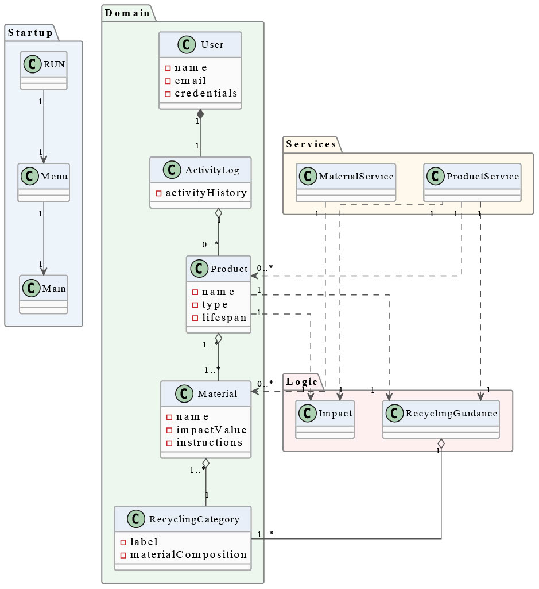

# Sustainable Product and Recycling Management System SDG 12

## Project Description
This project is a structured, menu-driven console application developed. It is designed to manage products and reusable materials, compute environmental impact metrics, and provide recycling guidance. The system is built with a strong focus on software engineering principles, including architecture, clear separation of responsibilities, testability, maintainability, and comprehensive documentation. Additionally, it reflects a professional development workflow rather than focusing solely on feature implementation.

## Purpose of system
-	Help users understand how to dispose of and reuse products correctly.	
-	Reduce environmental waste by encouraging sustainable habits.
-   Provide useful information about product lifecycle and recycling methods.
-	Allow users to track their personal contribution to saving the environment.
-   A CI/CD pipepline and comprehensive UML documentation (Class and Sequence Diagrams).

## Group Members and Roles
- ***Abdul Bari Iqbal Chaudhry*** - Technical & Documentation 
- ***Vikram Khajuria*** - Manages github repository, branches and ensures clean code principles
- ***Pranav Joshi*** - UI console & code 

 ***Shared Roles***
- Shared roles are to learn the architecture together and implement things by collaborations.
- Goal is to learn the coding, logic seperations, testing and mock objects.
  

## Requirement Extraction

### Functional Requirements:
- Product Management
  - Create
  - List
  - Information Detail
- Material Management
  - Recycling Category
  - Reusability
- Environmental Impact Calculation
  - Total Impact Calculation
  - Interchangeable Strategies
  - Startegy Pattern
- Recycling Guidance
  - Material Composition
  - Mixed-Material Documentation

### Non-Functional Requirements:
- Arquitectural
  - Application Type: Menu Driven Console
  - Layered Arquitecture: Presentation & Domain visualization 
  - Strict Separation Between UI & Business Logic
  - Strategy Patterns: Documented
  - JUnit Tests: No console UI code in tests

- Qualities & Constraints
  - Maintainability
  - Continuous Integration: Builds projects and runs tests automatically
  - Meaningful commits

## Domain Concept Identification

| Concepts(Nouns) | Responsibilities(verbs) |
|------|-----|
| Product | Create |
| Material | List |
| Impact | View |
| Category | Calculate |
| Lifespan | Define |  
| Strategy | Provide |
| Recycling Guidance | Replace |

## System Boundaries

## UML Diagram

